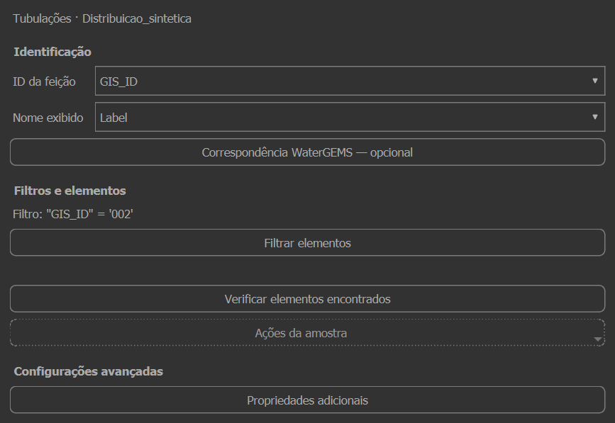
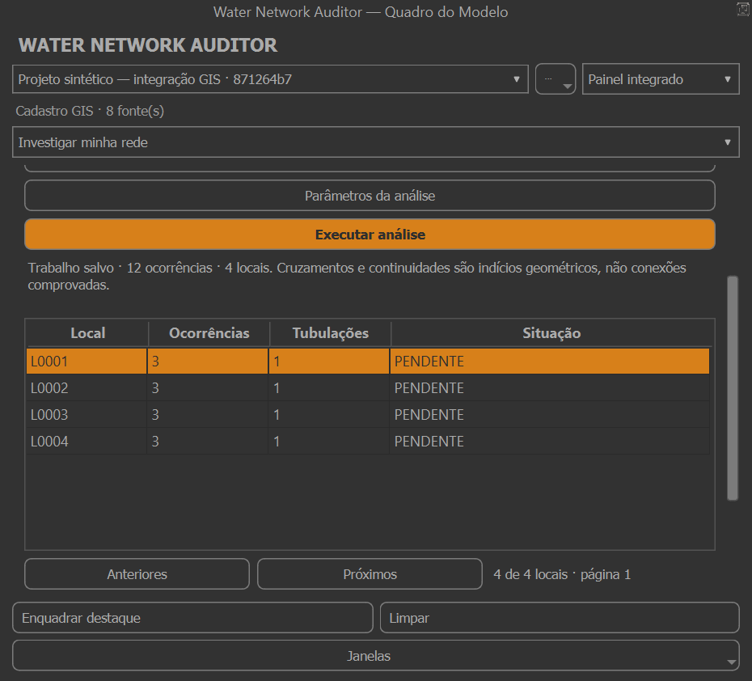
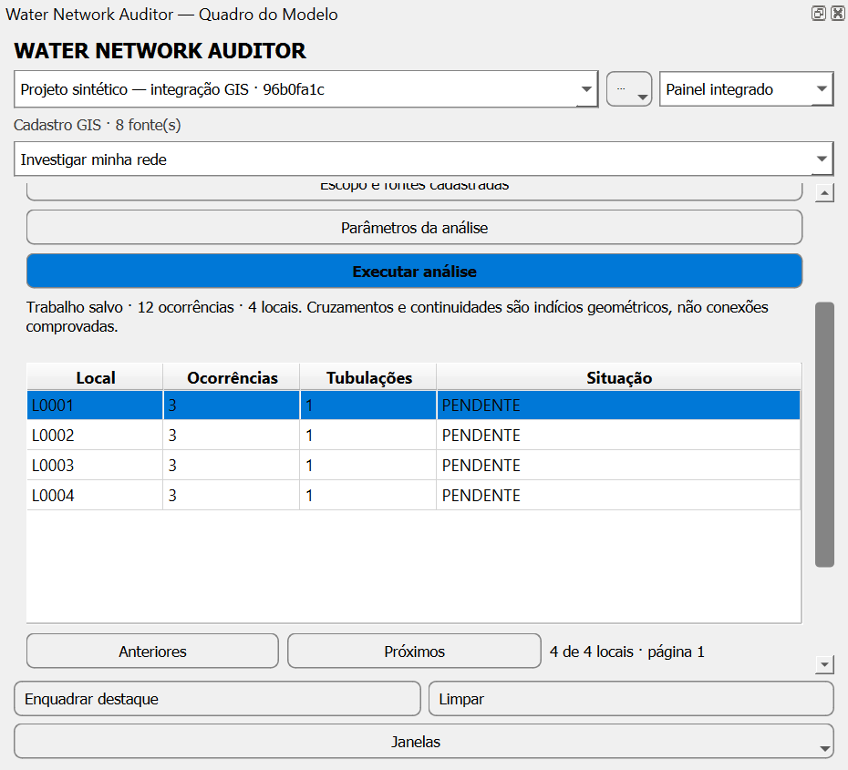
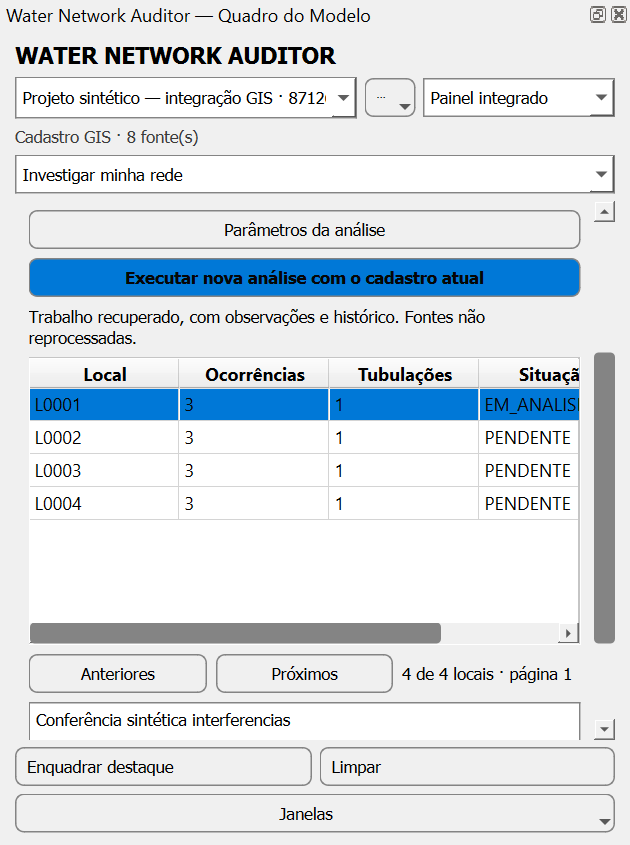

# Modelo GIS nas análises — Entrega 1 / 1.15.0

Pré-release de validação. Esta entrega liga o cadastro multifonte ao motor geométrico existente. A topologia GIS independente (Entrega 2) e a consolidação completa de propostas e histórico (Entrega 3) continuam pendentes; esta versão não representa a conclusão dessas etapas.

## O que mudou

Na 1.14.3, as entradas GIS da área Investigar encaminhavam para o formulário legado de auditoria, que solicitava novamente camadas e campos. Agora **Verificar rede GIS**, **Zonas e fronteiras** e **Interferências espaciais** abrem uma página contextual no próprio ambiente. As fontes, filtros, campos e identidades vêm do Modelo GIS salvo. WaterGEMS não é requisito dessas três entradas.

O editor de fontes ganhou seções Identificação, Filtros e elementos, Relações com a rede (quando aplicável) e Configurações avançadas. O filtro visual e o Modo especialista estão no mesmo agrupamento; ações da amostra ficam em um menu. Nome da VRP permanece opcional, separado da identidade. Correspondência WaterGEMS é opcional. Não há responsável, documento ou aceite obrigatório.

## Como usar no QGIS

1. Instale o ZIP pelo gerenciador de complementos, opção **Instalar a partir do ZIP**, e reinicie o QGIS.
2. Em Preparar minha rede, escolha o projeto, cadastre Tubulações e áreas de referência e salve o Modelo GIS. Fontes de equipamentos podem permanecer cadastradas para consulta e etapas posteriores.
3. Abra Investigar minha rede e escolha Verificar rede GIS, Zonas e fronteiras ou Interferências espaciais. Execute a análise. Não é necessário selecionar novamente as fontes.
4. Opcionalmente, expanda Escopo e fontes cadastradas para escolher categorias de áreas. Parâmetros da análise contém CRS métrico, tolerâncias e pasta dos trabalhos.
5. Consulte os locais, destaque no mapa e use Enquadrar somente quando desejar alterar o zoom. Registre uma observação e salve. Histórico e exportações contém o histórico do local, exportação SHP e acesso explícito ao visualizador anterior.
6. Reabra pelo item da auditoria em Meus trabalhos. O GeoPackage é lido sem reprocessar as fontes. A página identifica o objetivo original; uma nova execução usa o cadastro atual e gera outro arquivo.

O resultado completo já fica no GeoPackage publicado. A exportação opcional Shapefile gera uma pasta nova com arquivos auxiliares, tabelas CSV e dicionários do exportador existente. Não sobrescreve exportações anteriores.

## Alcance técnico

| Entrada | Processamento existente utilizado | Limite |
|---|---|---|
| Verificar rede GIS | Ocorrências geométricas junto aos perímetros cadastrados | Não é uma verificação completa de conectividade |
| Zonas e fronteiras | Modo de transições entre regiões | Sobreposições e ambiguidades permanecem explícitas |
| Interferências espaciais | Cruzamentos, tangências e coincidências com fronteiras | Não é uma nova análise geral de interferências entre todos os tubos |

O motor atual precisa de tubulações e pelo menos uma fonte poligonal escolhida. Sem áreas, a página informa essa dependência; não simula uma auditoria de conectividade. Verificar rede GIS e Interferências reutilizam o mesmo modo de perímetro, com explicações próprias. Não se acrescentou um segundo motor.

Equipamentos são registrados como contexto; este adaptador não associa válvulas por proximidade nem aplica relações manuais de Reservoir/Tank como arestas. Construir o grafo e revisar conexões pertence à Entrega 2. Cruzamentos, proximidade, continuidades candidatas e agrupamento de locais não comprovam conexão hidráulica.

## Arquitetura e integridade

- `analise_modelo_gis.py`: adaptador de leitura, captura das fontes, filtros independentes, transformação de cópias para CRS métrico e proveniência da configuração/revisão. O mesmo provedor pode participar em categorias e filtros diferentes com identidades próprias.
- `analise_gis_ui.py`: página criada sob demanda, worker compartilhado, lista paginada de até 200 locais, observações e histórico existentes, reabertura, destaque temporário e exportação.
- `ambiente.py` e `controlador.py`: entrada contextual, recuperação de trabalhos GIS e proteção de observações não salvas ao trocar contexto ou encerrar.
- `modelo_gis_ui.py` e `mapa_fontes.py`: organização do editor e destaque temporário de geometrias de resultados.
- `persistencia.py`: consulta do CRS persistido pelo SQLite, sem abrir um provedor de camada para essa verificação. A igualdade do CRS continua obrigatória.
- `exportacao.py`: contexto de transformação copiado e pontos de cancelamento no exportador SHP; chamadas antigas continuam compatíveis.
- `fluxos.py`: o reprocessador legado não pode ignorar silenciosamente os filtros de uma execução criada pelo Modelo GIS; orienta executar novamente pelo Quadro.

As camadas QObject são resolvidas na thread principal. O worker recebe fontes de feições próprias e contexto de transformação copiado. Geometrias reprojetadas são cópias; seleções, filtros da camada original e renderizadores não são alterados. O cálculo e a gravação extensa usam o worker existente. A inicialização do contêiner e a publicação das camadas QGIS ficam na thread principal.

Cada execução tem UUID e arquivo novo. A gravação ocorre em temporário próprio, com verificação de integridade SQLite e presença da execução, antes da publicação sem sobrescrever destino existente. Alterações do projeto, revisão, mapeamentos, filtros ou fontes impedem publicar um resultado preparado em contexto diferente. Cancelamento não publica o temporário; botões são restaurados inclusive quando o gerenciador descarta um resultado já recebido. A fase final de publicação é crítica e não admite cancelamento.

Observações utilizam a tabela de revisões existente, com controle de revisão esperada. Cancelar uma mudança de contexto mantém o texto; Salvar e Descartar continuam disponíveis quando há rascunho. Nenhum novo cadastro ou histórico paralelo foi criado. A abertura de bases usa conexão somente leitura.

## Testes e evidências

Ambiente: Windows 64 bits, QGIS Desktop 3.44.15-Solothurn, Python 3.12.15 empacotado no QGIS. Dados sintéticos em EPSG:31983; nenhum modelo hidráulico real necessário. Os testes usam perfil isolado e o complemento extraído do ZIP, incluindo `_biblioteca`.

A suíte anterior possui 1.361 testes. Foram acrescentadas 31 regressões no módulo `test_integracao_modelo_gis.py`, cobrindo filtros, identidade, CRS diferentes, erro de fonte, equivalência com o motor, persistência, cancelamento, contexto, histórico, reabertura, objetivo original, confirmação única ao cancelar e ausência de duplicação.

Resultado: **1.392 testes aprovados em 41 módulos**, em execução completa de 431,58 s. Após a proteção do receptor Qt responsável pela rolagem, o módulo novo de 31 casos foi repetido dez vezes em processos isolados, todos com código zero. As repetições não são contadas como testes novos.

Execuções intermediárias PyQGIS apresentaram encerramentos nativos intermitentes, inclusive código Windows `0xC0000409`, durante testes com várias instâncias de interface. Foram consideradas falhas e preservadas nos logs locais. A investigação incluiu rastreamento de callbacks, mensagens Qt e limpeza explícita do runtime. O callback adiado de apresentação passou de lambda para slot Qt do próprio widget, com ciclo de vida gerenciado. A falha não se repetiu nas dez execuções posteriores do módulo, mas isso não comprova uma causa única nem elimina a necessidade de ensaios operacionais prolongados. Um roteiro diagnóstico sem limpeza do runtime também produziu violação de acesso no encerramento; esse resultado não foi contado como teste aprovado.

Um primeiro ensaio Desktop falhou por atributo incompatível no próprio roteiro sintético e expirou no diálogo de salvamento; não foi considerado encerramento bem-sucedido. O roteiro foi corrigido. Os três processos finais do pacote instalado concluíram com código zero e `aboutToQuit`.

O ensaio Desktop exercita oito fontes configuradas: duas redes, PRV, TCV, Tank e três categorias de áreas. Um filtro exclui um ID textual, preservando seus zeros à esquerda. Cada análise produz 12 eventos e quatro locais neste exemplo. Registra duas observações por trabalho, confere reabertura, exporta SHP, verifica preservação dos GeoJSON por hash e ausência de duplicação das camadas. O cancelamento é seguido por nova execução bem-sucedida. Os três processos finais devem apresentar `aboutToQuit` e código zero; timeout é falha, nunca encerramento válido.

Esses ensaios automatizados com janelas reais complementam os testes PyQGIS. Não equivalem a aceitação humana de um cadastro operacional, ensaio de escala municipal ou teste físico de dois monitores.

Medições de referência no Desktop, 32 alternâncias de grupos por tema, oito fontes sintéticas já carregadas:

| Tema | Mediana de seleção de grupo | P95 | Pior caso |
|---|---:|---:|---:|
| Escuro | 1,72 ms | 2,95 ms | 3,52 ms |
| Claro | 1,60 ms | 2,58 ms | 3,11 ms |

Neste pequeno exemplo, cálculo e publicação das três análises demoraram entre 0,24 e 0,28 s. São medições de chamadas no hardware local, sob automação e com outras regressões em execução; não constituem benchmark controlado, não medem o tempo perceptivo de toda a pintura do Qt e não garantem desempenho com modelos extensos. A inicialização do contêiner GPKG, a validação de metadados e a publicação das camadas ainda ocorrem na thread principal.

### Capturas reais

Somente dados fictícios. A lista de resultados e as observações podem exigir rolagem em painéis baixos. Após concluir uma execução, a página mostra a área dos resultados.

Capturas adicionais: [filtros](capturas/integracao_modelo_gis/filtros.png), [local no mapa](capturas/integracao_modelo_gis/mapa.png), [janela independente](capturas/integracao_modelo_gis/independente.png) e [painel estreito](capturas/integracao_modelo_gis/estreito.png). Para comparação, veja o [editor e os fluxos da 1.14.3](AJUSTES_GIS_1_14_3.md).

## Roteiro manual de aceitação

1. Cadastre duas camadas de rede e áreas de setor, VRP e booster; use um filtro que exclua uma feição conhecida. Salve e reinicie.
2. Execute as três entradas GIS sem abrir WaterGEMS. Confira que não aparece Nova Auditoria, que o filtro é aplicado e que os IDs originais permanecem acessíveis.
3. Confira uma fonte ausente, um filtro inválido e CRS incompatível. Corrija no cadastro, sem refazer todas as seleções. Confirme que trabalhos anteriores continuam íntegros.
4. Execute com CRS distintos válidos; compare posições e unidades. Não aceite graus como metros. Confira fontes e parâmetros registrados na proveniência.
5. Destaque um local, observe que o zoom não muda e só então enquadre. Confira simbologia e seleção das fontes originais.
6. Salve duas observações. Teste Salvar, Descartar e Cancelar ao tentar sair com rascunho. Reabra o trabalho em outra sessão e confira histórico e objetivo.
7. Cancele uma análise; execute novamente. Tente executar repetidamente e fechar o QGIS durante uma operação crítica. Não aceite resultado parcial como sucesso.
8. Exporte SHP e abra os arquivos gerados. Compare contagens, chaves, CRS, tabelas e avisos sobre limites DBF com o GeoPackage.
9. Alterne painel e janela, temas e largura. Confira rolagem, texto, localização dos resultados e ausência de instâncias duplicadas.

## Próximas entregas

| Entrega | Situação nesta pré-release |
|---|---|
| 1 — Modelo GIS nas ferramentas existentes | Implementada; validação sintética automatizada e Desktop, com aceitação operacional ainda a executar |
| 2 — Topologia GIS independente | Não implementada nesta pré-release: extremos, candidatos, revisão de conexões, grafo, componentes e alcançabilidade |
| 3 — Interface de investigação e histórico | Pendente: visualizadores de propostas e itens de trabalho, filtros e exportações contextuais consolidados |

A 1.14.3 permanece disponível para comparação e retorno. Não se alteraram os algoritmos geométricos ou hidráulicos, modelos WaterGEMS, cadastros GIS originais ou registros históricos existentes.
