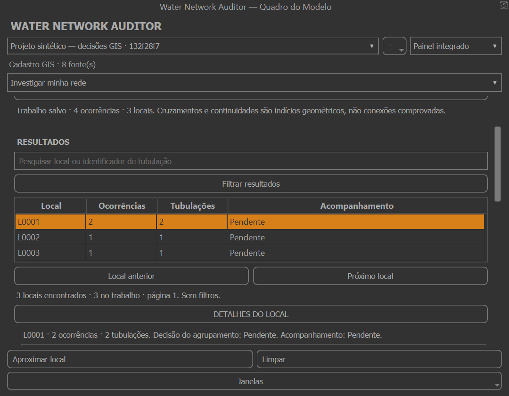
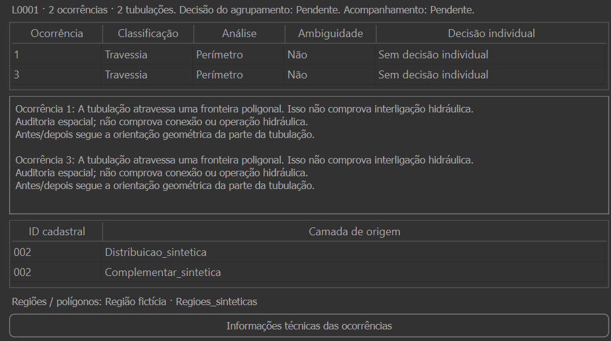
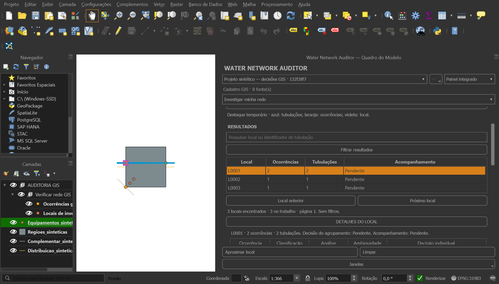
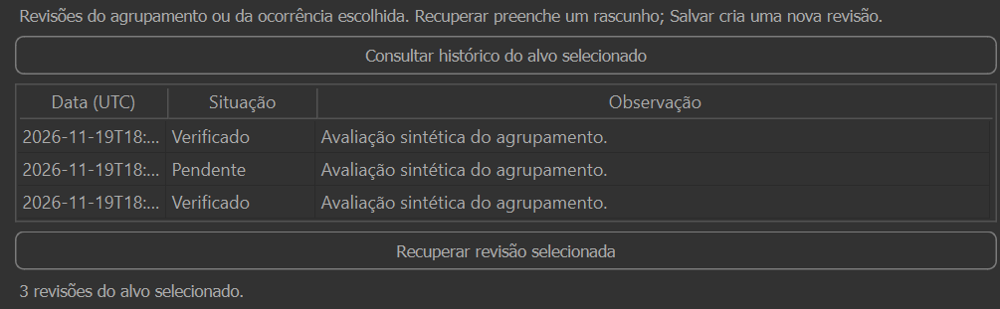

# Investigação GIS — detalhes e decisões / 1.15.1

Pré-release corretiva da experiência de investigação da 1.15.0. Não inicia a construção da topologia GIS independente e não altera o motor geométrico ou o agrupador.

## Diagnóstico

A 1.15.0 preservava eventos, referências de tubulações, polígonos e vínculos, mas sua página mostrava somente contagens e o ponto representativo. `salvar_observacao()` exigia texto e gravava sempre `EM_ANALISE`. `REVISOES` guarda avaliações de locais; `REVISAO_EVENTO` relaciona a revisão do agrupamento aos eventos, sem representar decisões individuais independentes.

As estruturas existentes foram reutilizadas: `detalhes_local`, dossiê e vínculos, `salvar_revisao`, histórico imutável, gravação concorrente por revisão esperada, GeoPackage, exportador SHP, workers, destaques temporários, Quadro do Modelo e preferências de apresentação.

## Usar a investigação

Instale o ZIP pelo gerenciador de complementos e reinicie o QGIS. Abra um trabalho GIS em Meus trabalhos ou execute a análise a partir do Modelo GIS.

1. **RESULTADOS:** pesquise pelo ID do local ou pelo identificador de tubulação. Filtros combinam situação de acompanhamento, classificação da ocorrência e categoria da análise (perímetro ou transição). A pesquisa percorre o índice de todos os locais, independentemente da página de 200 linhas. A mensagem informa total encontrado e filtros ativos. Há navegação por local e, nos filtros, por página.
2. **DETALHES DO LOCAL:** consulte as ocorrências, suas classificações, modo de análise, ambiguidade, descrições, tubulações, camadas e polígonos. Informações técnicas ficam recolhidas. A ordem original dos eventos e referências é preservada pelo índice.
3. **ANÁLISE E DECISÃO:** escolha Agrupamento ou uma ocorrência em Analisar. Clicar na tabela de ocorrências também seleciona o alvo. Situação e observação pertencem ao alvo mostrado nesse seletor.
4. Selecione Pendente, Em análise, Verificado, Descartado ou Necessita confirmação e clique **Salvar decisão**. Observação é opcional. Salvar texto não muda automaticamente a situação.
5. **HISTÓRICO:** consulte as revisões do alvo selecionado. Recuperar revisão preenche um rascunho; Salvar registra uma nova revisão, sem alterar as antigas. Para reabrir, grave Pendente ou Em análise.
6. **EXPORTAÇÃO:** escolha GeoPackage completo ou Shapefile e tabelas. O visualizador anterior permanece somente em Compatibilidade avançada.

Se houver rascunho ao mudar de alvo, local ou contexto, Salvar, Descartar e Cancelar preservam o controle do usuário. Gravações individuais acontecem em worker; uma navegação que dependa dessa gravação aguarda sua conclusão. Não há responsável, aprovação formal, documento ou justificativa obrigatória.

Ao carregar resultados, os parâmetros de execução ficam recolhidos em **Configurar / executar nova análise**, liberando espaço para a investigação. Esses parâmetros continuam disponíveis e não exigem recadastrar fontes.

## Situação do local e situação das ocorrências

São informações separadas. Uma revisão do agrupamento não cria revisões individuais. Revisões antigas vinculadas por `REVISAO_EVENTO` não são convertidas em decisões individuais.

| Condição | Acompanhamento exibido na lista |
|---|---|
| Nenhuma decisão individual | Situação histórica registrada no agrupamento |
| Existem decisões individuais | Considera todos os eventos do local; os ainda não avaliados individualmente permanecem Pendentes |
| Todos os estados individuais considerados são iguais | Estado comum |
| Há estados diferentes | Situações mistas |

O detalhe mostra sempre a decisão do agrupamento e o acompanhamento. A tabela de ocorrências distingue Sem decisão individual de uma decisão Pendente explicitamente salva. Um agrupamento Verificado com ocorrências individuais pendentes não é apresentado como integralmente verificado no acompanhamento.

`VERIFICADO` expressa a avaliação registrada pelo usuário. Não significa correção executada, conexão hidráulica comprovada ou validação operacional. Classificação, geometrias e prioridades originais não são substituídas por essa situação.

O campo histórico `SITUACAO` da camada GPKG de locais continua representando a revisão do agrupamento. O acompanhamento calculado está no novo painel e em `SITUACOES_LOCAIS.csv`. Visualizadores e relatórios legados podem apresentar somente a decisão do agrupamento; decisões individuais devem ser consultadas no novo painel e nas tabelas novas.

## Mapa

- Azul: linhas das tubulações relacionadas ao alvo.
- Laranja: geometria das ocorrências selecionadas, incluindo trechos coincidentes quando presentes.
- Quadrado violeta: ponto representativo do local, que não substitui os eventos individuais.

Destacar não altera o zoom. **Aproximar local** utiliza os elementos do alvo efetivamente selecionado. Usa enquadramento mínimo de 30 m no CRS métrico da análise e margem de 15%. Quando um tubo extenso afastaria a vista do local, foca os eventos: compara a extensão total com uma janela de referência de 200 m ou quatro vezes a extensão dos eventos, prevalecendo a maior. O desenho das tubulações continua integral. **Ver toda a extensão dos elementos** permite enquadrar o conjunto completo. Fora da página de investigação, o comando compartilhado continua denominado Enquadrar destaque.

São rubber bands gerenciados pela ferramenta; não alteram fontes, renderizadores ou seleções de entrada. A troca de alvo limpa seu destaque anterior. Há comando explícito para limpar.

### Geometrias em trabalhos antigos

A 1.15.0 guarda WKB técnico dos eventos, mas não necessariamente a linha completa de cada tubo no dossiê. Para esses trabalhos, a recuperação usa provedor e URI exatos, CRS original, atributos e assinatura geométrica. Não utiliza Label, ID isolado, nome de camada, FID ou proximidade como identidade suficiente. Uma busca por ID examina até 1.001 candidatos; se o limite for atingido ou houver ambiguidade, não escolhe uma feição.

A recuperação de linhas antigas é executada em worker com fontes de feições capturadas na thread principal. Geometrias são transformadas somente quando o CRS e a assinatura permitem verificar a correspondência. Fontes ausentes, modificadas, CRS alterado e cópias ambíguas geram aviso. O ponto/evento preservado pode ser destacado mesmo sem uma linha confiável.

Novas análises armazenam também WKB das tubulações envolvidas, no CRS de processamento, aproveitando a leitura já feita para configuração. Não se armazena a rede inteira para cada seleção. Esses desenhos são representações da execução histórica; não afirmam que o cadastro atual continua igual.

## Persistência compatível

Revisões do agrupamento continuam nas tabelas existentes. Ao salvar a primeira decisão individual, a extensão cria:

- `REVISOES_OCORRENCIAS_SCHEMA`, versão 1.
- `REVISOES_OCORRENCIAS`: UUID da revisão, execução, evento, situação, observação, data UTC e revisão anterior.
- Índice por execução/evento, chaves estrangeiras e triggers que impedem alteração ou exclusão de histórico.

Antes dessa extensão é criado um backup SQLite verificado, com nome `*_antes_decisoes_ocorrencias_*.gpkg` e evidência `.verificacao.json`. A criação das tabelas é transacional. A gravação utiliza `BEGIN IMMEDIATE` e confere a revisão esperada, impedindo sobrescrever uma decisão concorrente. Se o backup falhar, não se prossegue com a extensão. A versão do esquema principal permanece compatível; não há exclusão ou reinterpretação dos registros existentes.

Abrir um arquivo antigo é somente leitura e não cria essa extensão. Nenhum arquivo GIS original ou WaterGEMS é escrito. Backups técnicos permanecem locais e devem ser preservados conforme a política de recuperação. A etapa crítica de gravação não admite cancelamento e bloqueia o encerramento enquanto estiver em execução.

## Exportar o trabalho

**GeoPackage completo:** cópia consistente SQLite, verificação de integridade e da execução, incluindo todo o histórico e a extensão individual. O destino deve ser novo; a publicação não sobrescreve um arquivo existente.

**Shapefile e tabelas:** mantém o exportador existente, seus auxiliares e dicionários e acrescenta:

- `SITUACOES_LOCAIS.csv`: decisão do agrupamento e acompanhamento separados.
- `DECISOES_OCORRENCIAS.csv`: últimas decisões individuais.
- `HISTORICO_OCORRENCIAS.csv`: todas as revisões individuais.
- `HISTORICO_LOCAIS.csv`: histórico dos agrupamentos.

As tabelas são lidas numa transação somente leitura. Se as revisões diferirem do contexto aberto por alteração em outra sessão, a exportação é interrompida e o usuário deve reabrir o trabalho. A saída SHP é publicada somente ao concluir; falhas/cancelamentos preservam exportações anteriores e podem deixar uma pasta temporária identificada. CSVs não são um importador automático WaterGEMS.

## Desempenho e arquitetura

`IndiceInvestigacao` constrói uma vez mapas por UUID e índices de vínculos, textos, classificações e modos. Selecionar local recupera somente seus membros; não repete as varreduras de todos os eventos usadas pelo contrato antigo sem índice. `detalhes_local` aceita esse índice sem alterar seus chamadores antigos. Geometrias só são decodificadas para o alvo destacado. A página mantém widgets e limita a tabela a 200 resultados visíveis; tabelas pequenas ajustam sua altura.

Módulos alterados: `analise_gis_ui.py`, `analise_modelo_gis.py`, `ambiente.py`, `mapa_fontes.py`, `inspecao.py` e metadata. Módulos novos: `investigacao_gis.py`, `painel_investigacao_gis.py`, `geometrias_investigacao.py`, `exportacao_investigacao_gis.py` e `revisoes_ocorrencias.py`. Motores `nucleo.py` e `investigacao.py` não foram modificados.

## Validação e limitações

Ambiente: Windows 64 bits, QGIS Desktop 3.44.15-Solothurn / Python 3.12.15. Testes unitários usam dados sintéticos e runtime PyQGIS real. A suíte anterior de 1.392 testes foi preservada. O módulo novo cobre decisões, estados mistos, concorrência, migração e backup, recuperação, pesquisa em 745 locais, múltiplas fontes, IDs repetidos, geometrias, mapa, exportação e compatibilidade.

Resultados consolidados: **1.432 testes únicos aprovados**. A suíte completa executou 1.427 testes em 42 módulos, em 786,23 s. O módulo novo foi ampliado de 35 para 40 testes e reaprovado em três processos isolados; essas repetições não aumentam a contagem de testes únicos. A verificação final também repete os módulos de integração e investigação após o último ajuste de apresentação.

O ensaio Desktop instala o ZIP num perfil isolado e executa quatro processos: tema escuro, tema claro, reabertura e compatibilidade. Confere decisões individuais, três revisões do agrupamento, estados mistos, SHP/CSV, GPKG, painel/janela, hashes das fontes e encerramento real. A compatibilidade usa cópia de uma investigação sintética efetivamente produzida pela 1.15.0; o arquivo anterior permanece intacto.

O trabalho sintético Desktop contém quatro eventos em três locais, incluindo um local com duas ocorrências e duas tubulações de fontes distintas com o mesmo ID textual `002`. O teste unitário de apresentação também cobre quatro eventos e duas tubulações no mesmo agrupamento. Isso não constitui ensaio do L0002 operacional de Franco da Rocha, nem confirmação da interpretação hidráulica desses eventos.

Falhas intermediárias de testes não são contadas como sucesso. A limpeza dos cenários embutidos foi ajustada para destruir janela e canvas de cada caso enquanto o runtime QGIS ainda está disponível, em vez de depender somente de fechar/ocultar e da coleta de lixo. Os resultados finais e as repetições estão no relatório de entrega.

Automação Desktop não equivale a aceitação humana de engenharia, teste físico de dois monitores ou demonstração de desempenho em escala municipal. Geometrias antigas sem correspondência comprovável permanecem indisponíveis. Os filtros são mantidos durante a navegação da página, sem criar um segundo cadastro ou modificar o dossiê original.

### Capturas reais, com dados fictícios

Outras evidências: [ocorrência individual](capturas/investigacao_gis_1_15_1/evento.png), [decisão](capturas/investigacao_gis_1_15_1/decisao.png), [exportação](capturas/investigacao_gis_1_15_1/exportacao.png), [tema claro](capturas/investigacao_gis_1_15_1/claro.png), [reabertura](capturas/investigacao_gis_1_15_1/reabertura.png), [arquivo 1.15.0](capturas/investigacao_gis_1_15_1/legado.png), [janela](capturas/investigacao_gis_1_15_1/janela.png) e [painel estreito](capturas/investigacao_gis_1_15_1/estreito.png).

## Roteiro manual de aceitação

1. Abra uma cópia da investigação 1.15.0. Localize o caso desejado por ID ou tubulação; confira que não houve reprocessamento e que os filtros ativos estão explícitos.
2. Compare as contagens e a lista de eventos com os vínculos do arquivo. Confirme camadas e identificadores, sobretudo IDs repetidos entre fontes.
3. Selecione cada evento. Confira descrição, polígonos, ambiguidade e tubulações, sem deduzir conexão física a partir de contato geométrico.
4. Destaque o agrupamento, depois um evento e somente as tubulações. Confira que as fontes e suas simbologias permanecem intactas e que Destacar não muda o zoom.
5. Use Aproximar local e Ver toda a extensão em um tubo longo. Compare a vizinhança e o conjunto completo. Confira o aviso quando uma linha antiga não puder ser recuperada.
6. Salve Verificado sem observação numa ocorrência; mantenha outra Pendente. Confira Situações mistas e a decisão independente do agrupamento.
7. Altere, reabra e consulte o histórico. Recupere uma revisão como rascunho e salve. Teste Cancelar e Salvar ao mudar de alvo com texto pendente.
8. Reinicie o QGIS, reabra o mesmo trabalho e confira decisões e históricos. Em duas sessões, tente salvar sobre uma revisão que a outra sessão já alterou; o conflito deve preservar o rascunho.
9. Exporte GPKG e SHP/CSV para destinos novos. Confira membros, estados e revisões. Repita a abertura no tema claro/escuro e em painel estreito/janela.

A 1.15.0 permanece disponível para comparação e retorno. A nova topologia GIS continua fora desta correção.
