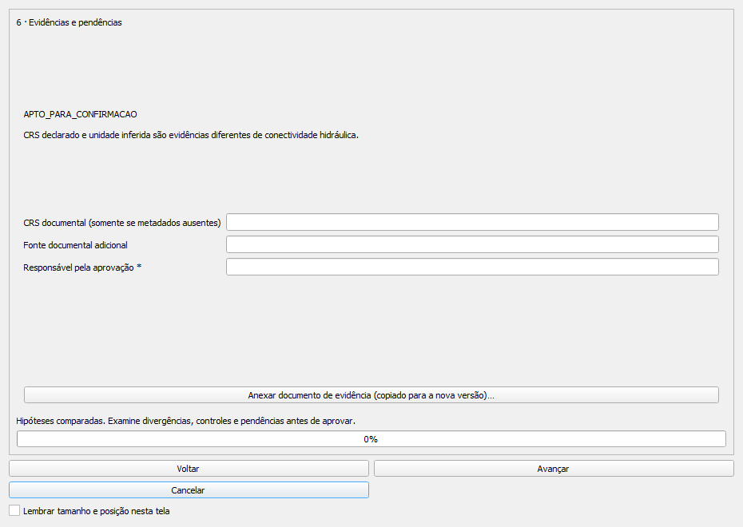
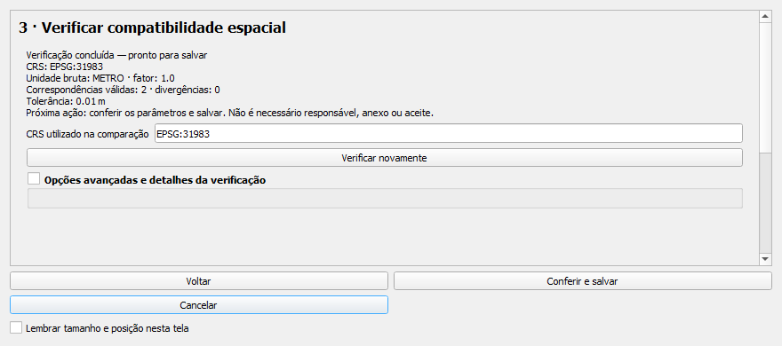
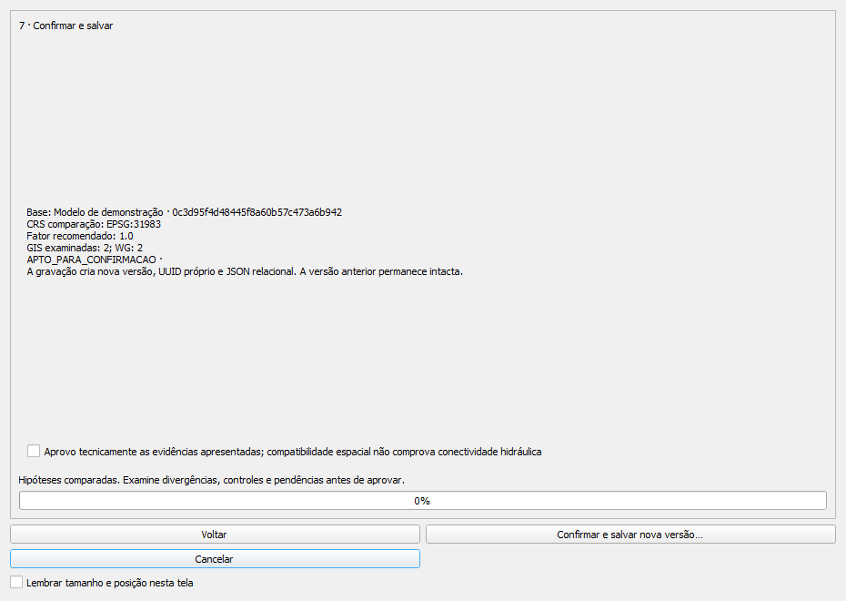
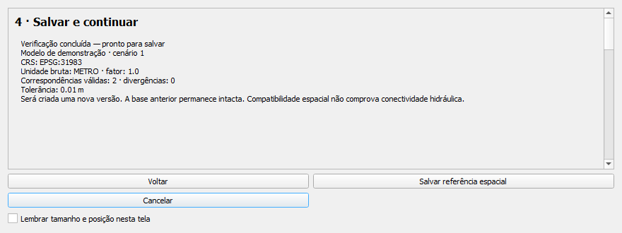
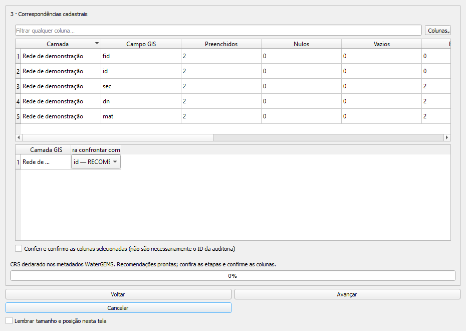
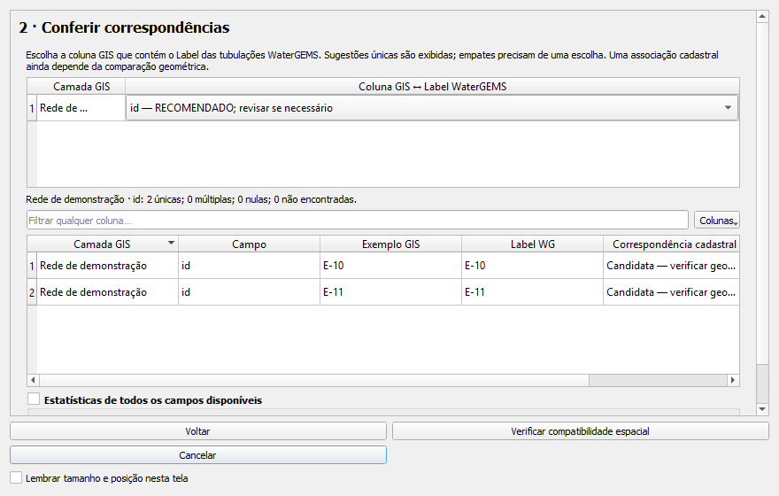
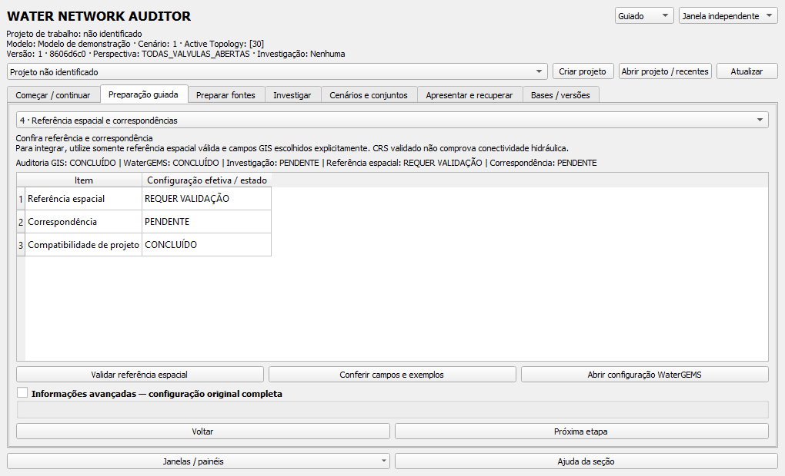
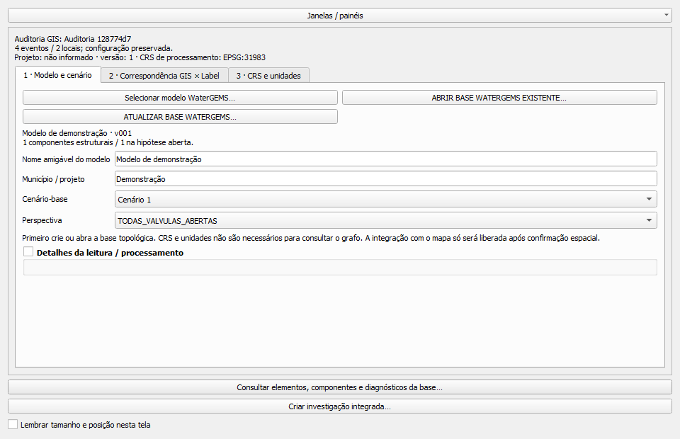
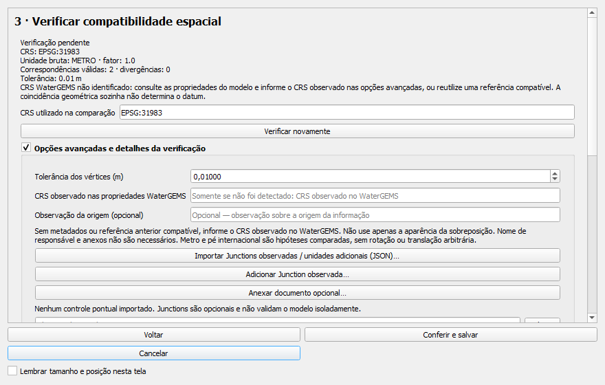
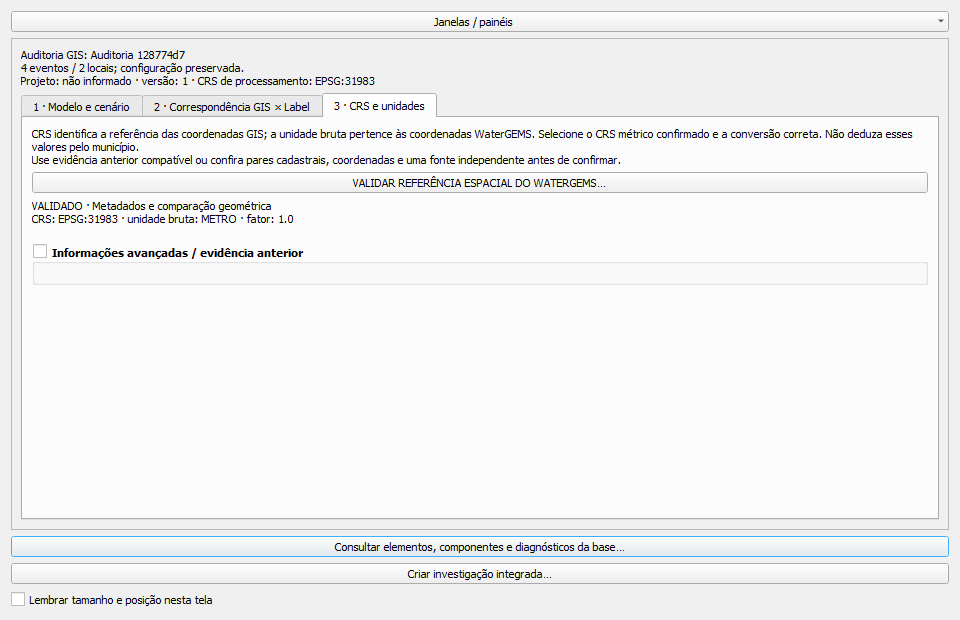

# Referência espacial sem formalidades — 1.12.1

O fluxo verifica dados e parâmetros. Não exige nome, identificação pessoal, aceite
jurídico, aprovação formal ou documento anexado. Não altera WaterGEMS ou GIS original.

## Diagnóstico da 1.12.0

A Central e a preparação guiada já organizavam as tarefas, mas o assistente
espacial ainda expunha sete páginas, tabelas extensas e controles administrativos.
A página de evidências exigia responsável; a última exigia aprovação por checkbox;
as colunas GIS também precisavam de aceite. O progresso ficava em 0% fora do
processamento e havia páginas de consulta com grandes áreas vazias.

Na configuração WaterGEMS, detalhes de leitura ocupavam o fluxo comum; cinco
colunas de correspondência e ações indisponíveis eram mostradas simultaneamente.

## Como utilizar

Na Central, use **Preparação guiada → Referência espacial e correspondências**.
Abra uma base WaterGEMS e uma auditoria GIS. Clique em **VALIDAR REFERÊNCIA
ESPACIAL DO WATERGEMS…**.

1. **Identificar os dados:** modelo, cenário, versão e CRSs são lidos
   automaticamente. Quando as fontes já estão selecionadas, o assistente avança
   diretamente às correspondências. Voltar permite consultar a identificação.
2. **Conferir correspondências:** sugestões únicas aparecem na tabela e podem ser
   alteradas. Exemplos, nulos, repetições e ausências são mostrados. Empates não
   recebem escolha arbitrária. Não há checkbox de confirmação.
3. **Verificar compatibilidade espacial:** a comparação mostra CRS, conversão,
   quantidade de pares válidos, divergências, tolerância e próxima ação.
4. **Salvar e continuar:** escolha um arquivo novo. O programa grava e verifica
   a versão, atualiza a configuração e fecha o assistente automaticamente.

Uma referência já verificada pode ser usada diretamente, sem repetir as quatro
etapas, quando contexto, fontes GIS, campos escolhidos e tolerância correspondem
ao registro persistido. Alterar parâmetros invalida a comparação em memória.

## O que foi removido ou recolhido

| Controle anterior | Tratamento atual |
|---|---|
| Responsável pela aprovação obrigatório | Removido do assistente |
| Aprovo tecnicamente as evidências | Removido |
| Conferi e confirmo as colunas selecionadas | Removido; são utilizadas as escolhas exibidas |
| Documento/anexo como etapa do fluxo | Opcional, em opções avançadas |
| Tabelas de todas as hipóteses e estatísticas | Recolhidas; continuam disponíveis |
| Junctions observadas e unidades adicionais | Opções avançadas |
| Metadados e proveniência completos | Detalhamento expansível |
| Progresso ocioso em 0% | Oculto fora do processamento |
| Botão cancelar processamento sem atividade | Oculto |
| Comparação com versão anterior | Detalhes da leitura; funcionalidade preservada |

As páginas curtas usam altura compacta. A opção de lembrar tamanho e posição e
a maximização preservam a escolha do usuário. Em telas menores há rolagem e os
botões finais continuam acessíveis.

## Segurança técnica preservada

O código continua exigindo CRS projetado em metros, unidade/fator compatíveis,
contexto exato, correspondências suficientes e hipóteses de unidade distinguíveis.
O comparador de todos os vértices permanece o mesmo. A tolerância não aumenta
automaticamente; não se ajustam rotação ou translação para obter coincidência.

Se o WaterGEMS não fornecer CRS e não houver referência anterior aplicável, a
comparação com o GIS continua como hipótese. **Coincidência geométrica sozinha
não prova datum.** Consulte o CRS nas propriedades WaterGEMS e, quando necessário,
informe o valor observado em **Opções avançadas**. O programa registra essa origem
como `CRS_COMPLEMENTAR_INFORMADO`, separada de `METADADOS_WATERGEMS` e
`REFERENCIA_ANTERIOR`. Não é obrigatório anexar arquivo nem identificar uma pessoa.
Isso não transforma a ferramenta em certificadora geodésica ou hidráulica.

Conflitos de metadados, unidade inconclusiva, CRS incompatível, controles alterados
e pares insuficientes continuam impedindo salvar como referência validada. A
consulta de conectividade, corredores e ilhas que não exigem coordenadas permanece
disponível sem essa validação.

## Contrato interno e compatibilidade

`confirmar_assistida()` depende da avaliação técnica. Os argumentos antigos
`aprovacao` e `responsavel` continuam aceitos para compatibilidade; o primeiro não
autoriza nem bloqueia o salvamento, e o segundo é opcional. Os metadados registram
o contrato `VERIFICACAO_TECNICA_SEM_APROVACAO_FORMAL`, origem do CRS, assinaturas,
parâmetros, estatísticas e contexto. `APTO_PARA_CONFIRMACAO` continua sendo código
interno, exibido como **Verificação concluída — pronto para salvar**.

`WB_EVIDENCIA` e a política de versionamento existentes são reutilizados: UUID
novo, referência à versão anterior, JSON técnico e transação de publicação. Não
há migração destrutiva. Campos antigos de responsável e aprovação não são apagados;
o reaproveitamento conserva os metadados da validação anterior.

Também foi retirada a obrigatoriedade de operador nas decisões históricas e
propostas. O aceite administrativo das propostas deixou de bloquear gravações.
Estados legados continuam disponíveis por compatibilidade; registrar VALIDADA
continua exigindo confronto técnico atual, identidades e cenário comparáveis. Um
resultado inconclusivo precisa de verificação técnica adicional fundamentada.
Salvar anotação, resultado investigativo ou proposta não altera o modelo.

## Capturas reais antes/depois

As duas versões foram instaladas em perfis temporários do QGIS 3.44.15. As imagens
abaixo são capturas reais de widgets, com dados de teste sintéticos; não são mockups
nem imagens geradas para representar uma interface inexistente.

| 1.12.0 | 1.12.1 |
|---|---|
|  |  |
|  |  |
|  |  |

Revisão visual interna: campos administrativos desapareceram; a lista inicial de
colunas foi reduzida; detalhes continuam acessíveis; páginas curtas perderam a
área vazia excessiva; progresso aparece somente durante operações. A aceitação
com os projetos e preferências do usuário permanece pendente.

## Roteiro de aceitação no QGIS

Validação automatizada: **1.250 testes aprovados**, mantendo os 1.229 anteriores
e acrescentando 21. Foram atualizadas as expectativas ligadas às formalidades
removidas. O resultado consolida a suíte completa e o reteste identificado do
módulo novo, cuja preparação de fixture foi corrigida. Logs iniciais foram mantidos;
falhas de preparação não foram contadas como testes aprovados.

O ZIP foi instalado no QGIS 3.44.15. Os ensaios por API Qt dentro do processo
desktop verificaram pendência de CRS, quatro etapas, gravação sem formalidades,
fechamento automático, preservação por hash das fontes e base anterior, versão
nova e reutilização. Outra sessão conferiu reuso, mesmo widget e rascunho da
configuração ao alternar painel/janela, com escala Qt 125%. Saída limpa foi
confirmada pelo código 0, sinal `aboutToQuit` e ausência de timeout.

A aceitação interativa pelo usuário permanece pendente; essas evidências não são
substituídas apenas por testes offscreen.

1. Instale o ZIP e reinicie o QGIS 3.44.15.
2. Pela preparação guiada, abra fontes GIS e WaterGEMS já persistidas.
3. Confira sugestões, altere uma coluna e consulte exemplos sem marcar aceite.
4. Verifique uma combinação válida e salve sem nome ou documento.
5. Confira nova versão, CRS, unidade e campos atualizados na configuração.
6. Feche e reabra; utilize a referência compatível sem repetir comparações.
7. Teste um campo incorreto, CRS inválido e conversão inconclusiva: confira o
   bloqueio técnico, o texto da pendência e a consulta topológica disponível.
8. Cancele antes de gravar e confira que a base anterior conserva seu conteúdo.
9. Expanda os detalhes e confira hipóteses, Junctions, proveniência e mapa.
10. Redimensione, alterne painel/janela e confira rascunhos e navegação guiada.

Ensaios automatizados, execução no QGIS instalado e revisão visual interna são
evidências diferentes da aceitação humana. Monitores e escalas físicas adicionais
continuam dependentes do equipamento disponível. A simulação Qt de escala 125%
não equivale a alterar o DPI do Windows.
