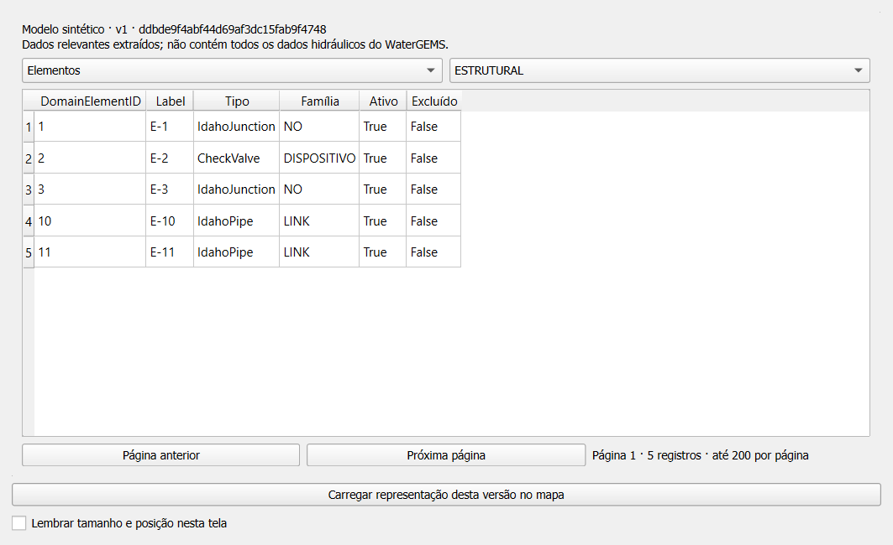
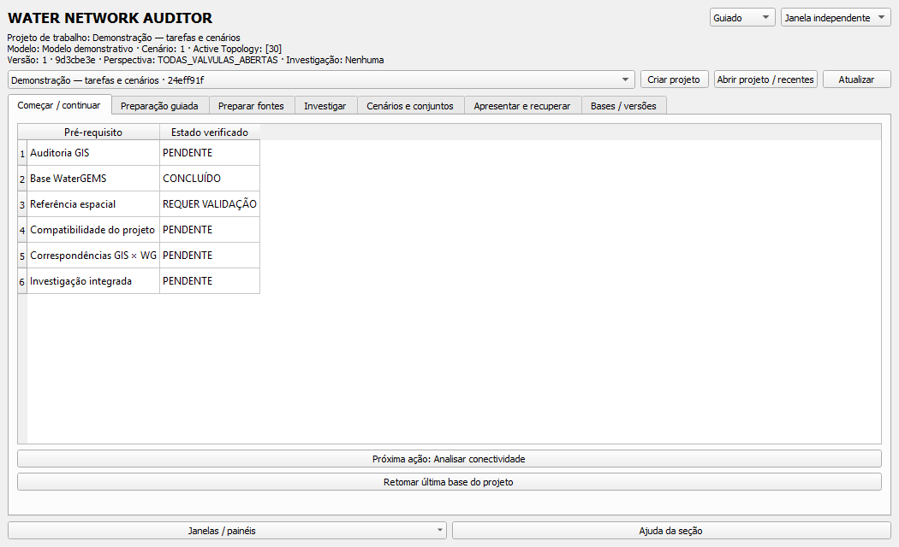
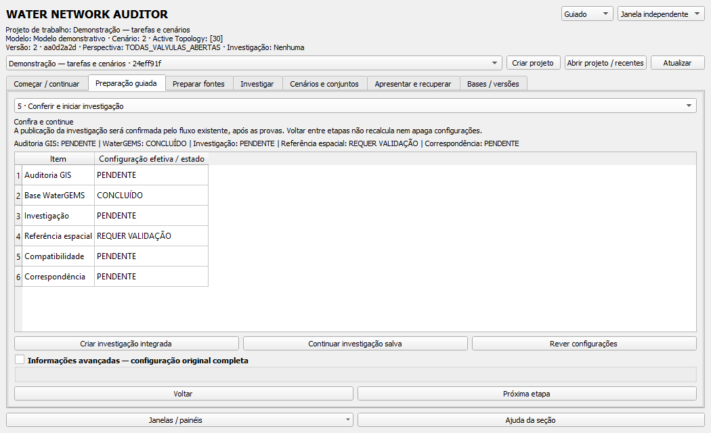
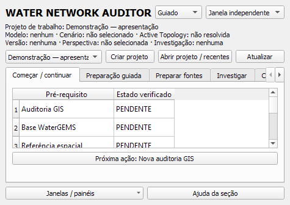
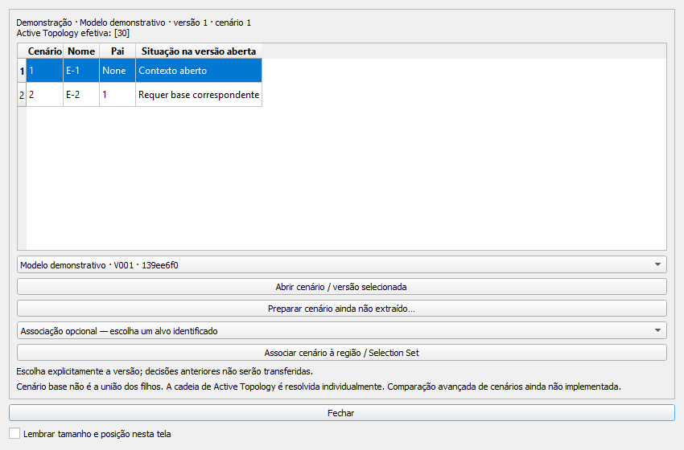
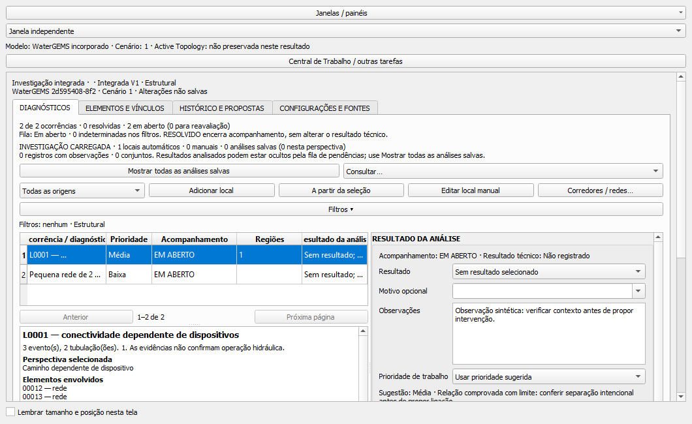
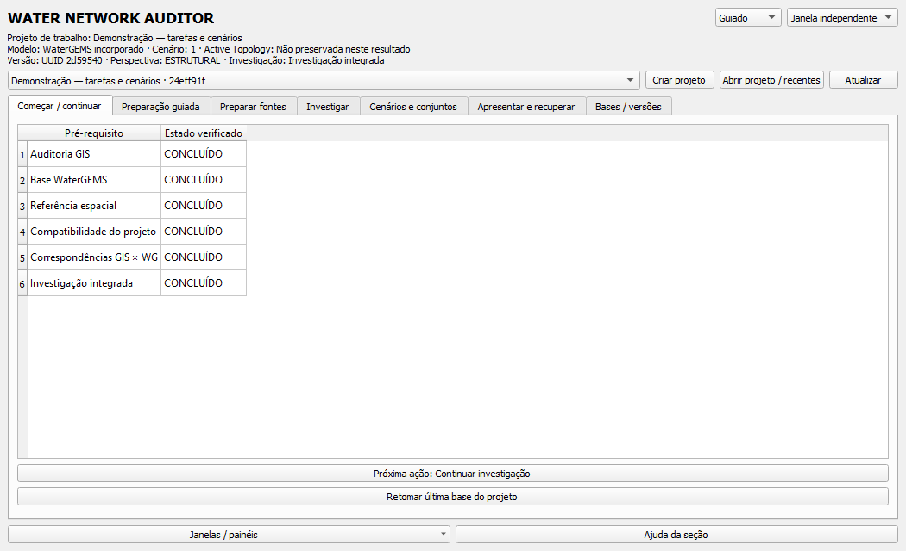

# Validação da interface guiada — 1.12.0

Data: 30/10/2026. Ambiente: Windows, QGIS 3.44.15, Python 3.12.
Esta é uma pré-release; aceitação pelo usuário permanece pendente.

## Diagnóstico e mapa da versão anterior

A 1.11.0 distribuía a navegação entre a auditoria GIS, configuração WaterGEMS,
catálogo e painel integrado. As ferramentas e guardas existiam, mas sua sequência
e seus requisitos não eram apresentados como um contexto de trabalho único.
Corredores e ilhas eram acessados pelo painel integrado, criando dependência de
interface com GIS mesmo para consultas que usam apenas o grafo.

| Antes | Agora |
|---|---|
| Entrada direta pelo formulário GIS | Central com projeto, requisitos e recomendação |
| Descobrir requisitos em mensagens de cada ferramenta | Contratos centrais e retorno à intenção original |
| Configurações distribuídas | Preparação guiada sobre os mesmos formulários |
| Corredores/ilhas acessados pela investigação | Consulta independente explícita, sem auditoria fictícia |
| Painel acoplado e janelas auxiliares | Mesmo conteúdo alternável entre painel e janela |
| Seleção de cenário durante extração | Explorador de cenários, versões e associação explícita |

## Entregas internas

As etapas foram implementadas e ensaiadas na ordem A → B → C → D. Os números
abaixo são cumulativos do módulo novo na ocasião, não devem ser somados.

| Entrega | Implementado | Testes específicos | QGIS instalado | Revisão visual interna | Aceitação do usuário |
|---|---|---:|---|---|---|
| A — Central e contratos | Sim | 16 | Sim, perfil isolado | Sim | Pendente |
| B — Preparação | Sim | 20 | Sim, formulários e assistente real | Sim; rolagem foi corrigida | Pendente |
| C — Apresentação | Sim | 25 | Sim, alternar/maximizar/restaurar | Sim | Pendente |
| D — Tarefas e contextos | Sim | 39 na versão final | Sim, cenário base → filho | Sim | Pendente |

Todas as capturas publicadas usam dados sintéticos. São imagens reais de widgets
do QGIS instalado, não desenhos de uma interface pretendida. Os primeiros ensaios
usaram pacotes intermediários; o ensaio final instalou o pacote desta pré-release.

### A — Consulta independente e requisitos

Consulta paginada recuperada de uma base persistida, sem exigir GIS ou CRS.
Na Central, abrir formulários não conclui etapas.

Revisão interna: estados distinguem base disponível de referência pendente; o
formulário completo continua acessível. Em painel estreito, as abas têm navegação
horizontal; a janela independente oferece maior área de trabalho.

### B — Preparação guiada

Revisão interna: etapas e ações existentes foram preservadas; a área passou a ter
rolagem após constatar excesso de altura no primeiro ensaio com escala Qt 125%.
A conferência mostra configurações efetivas e pendências, sem publicar resultados.

### C — Mesma interface em outra apresentação

Revisão interna: alternância preservou a identidade do widget e seu rascunho.
Maximização, minimização e recuperação foram exercitadas no processo QGIS. O
ensaio final conservou centro e escala do mapa durante o acoplamento.

### D — Cenários e investigação

Cenários sintéticos pai e filho foram extraídos separadamente pelo leitor
existente. A troca usou o UUID da base correspondente; o modelo original conservou
seu SHA-256. Nenhuma decisão foi transferida. Uma base não representa união de filhos.

Revisão interna: anotação, ocorrência selecionada e widget permaneceram os mesmos;
cancelar uma troca conservou o rascunho. Salvar produziu uma análise persistida,
recuperada em outra sessão. Dados de alternativa ausentes em resultados legados
são apresentados como não preservados, sem reconstrução presumida.

## Testes e limites da evidência

**1.229 testes aprovados:** 1.190 anteriores mantidos e 39 novos, em 34 módulos.
A validação consolida a execução completa por módulos e os retestes identificados.
A primeira execução teve um PermissionError transitório ao substituir o índice e
um timeout no teardown de teste, que aguardava o novo diálogo de saída WaterGEMS.
Foram acrescentadas tentativas limitadas de substituição e adaptada a limpeza do
cenário sintético. Os módulos foram reexecutados; os testes de cancelamento
continuam no corpo dos casos. Esses resultados iniciais não foram contados como
aprovações e seus logs foram preservados localmente.

O ensaio no QGIS instalado verificou corredor sem GIS, cenário base/filho,
alternância do painel integrado, rascunho, seleção, centro/escala do canvas,
cancelamento e anotação salva. A reabertura em outro processo recuperou o UUID,
a anotação e as preferências. Saída limpa exige código 0, sinal `aboutToQuit` e
ausência de timeout. Tentativas interrompidas do roteiro não equivalem a sucesso.

Um terceiro processo abriu o projeto `.qgz` salvo e recuperou a mesma investigação:
15 camadas próprias conservaram seus IDs, sem duplicação, e a análise salva foi
recuperada. Esse processo também encerrou com código 0 e sem timeout.

| Condição | Evidência |
|---|---|
| Tela física 1366 × 768, um monitor | QGIS desktop, escala 100%, área útil 1366 × 720 |
| Escala Qt 125% | QGIS com `QT_SCALE_FACTOR=1.25`; área lógica reduzida; não mudou a configuração DPI do Windows |
| 1920 × 1080 | Limites geométricos simulados por testes Qt; ensaio físico pendente |
| 2560 × 1440 | Ensaio físico pendente |
| Dois monitores e desconexão física | Pendente; recuperação de retângulo fora da tela testada por API |
| Escalas Windows 125/150/175/200% | Aceitação física pendente; não extrapolar a simulação Qt |
| Uso com arquivos operacionais | Aceitação pelo usuário pendente; capturas desta entrega são sintéticas |

Automação Qt dentro do QGIS, testes offscreen e revisão de capturas são evidências
distintas. Nenhuma delas constitui aceitação humana da experiência completa.

## Arquivos e preservação

Criados: `central.py`, `dependencias.py`, `contexto_trabalho.py`,
`preparacao_guiada.py`, `apresentacao.py`, `cenarios_ui.py`, `topologia_direta.py` e
`test_central_guiada.py`. Alterados: controlador, interface WaterGEMS, fixture de
limpeza dos testes, metadata do complemento, README, guia/arquitetura, LEIA_ME
local, gitignore, auditor de publicação e manifesto de imagens revisadas.

Algoritmos geométricos/topológicos e esquemas de resultados existentes permanecem
inalterados. Não foram editados modelos WaterGEMS, cadastros GIS ou bases privadas.
As capturas públicas são autorizadas individualmente por SHA-256. Caminhos,
credenciais, arquivos operacionais, índices de projeto e preferências locais ficam
fora do Git público.

O [guia de uso e roteiro de aceitação](CENTRAL_E_FLUXO_GUIADO.md) descreve as ações
para repetir os ensaios. Comparação avançada de cenários permanece futura;
`ESTADOS_DO_CENARIO` continua indisponível para análise validada.
